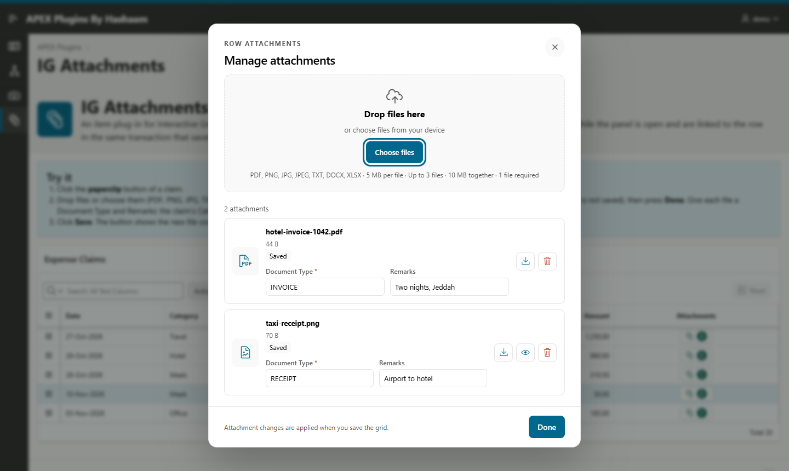
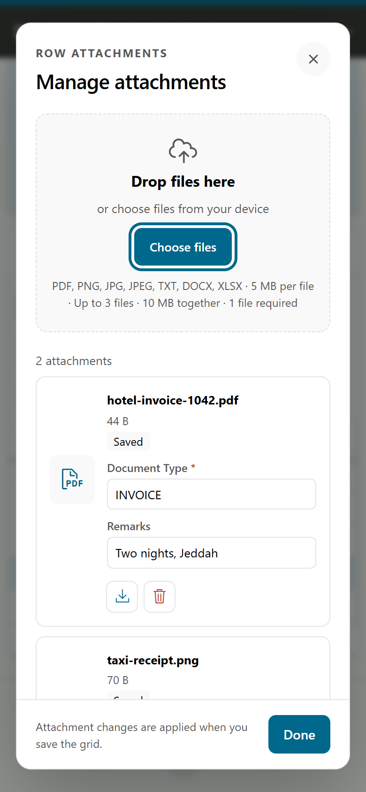
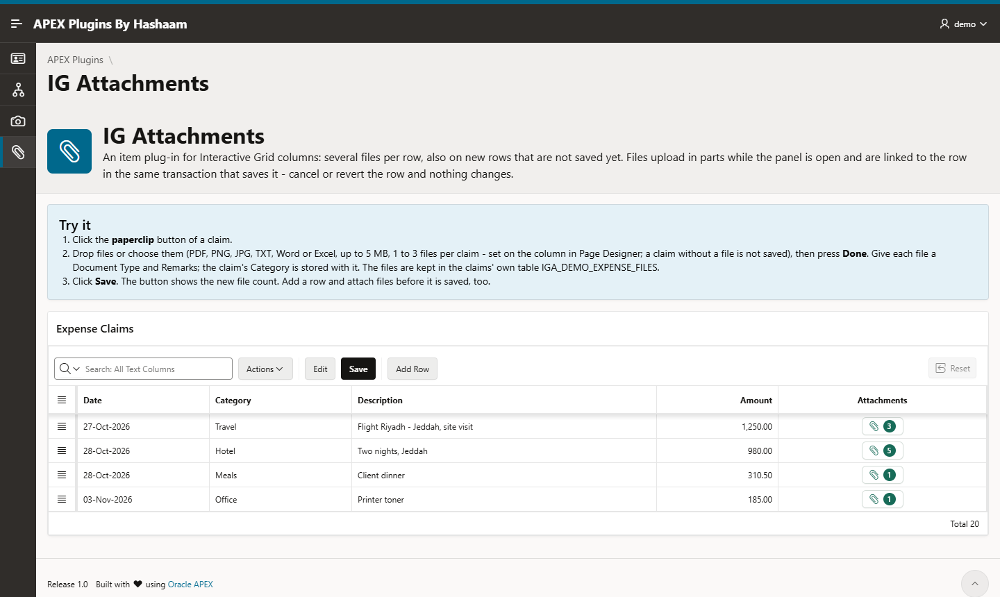

# IG Attachments for Oracle APEX

[](https://apex.oracle.com) [](LICENSE) [](CHANGELOG.md)

An item plug-in for Interactive Grid columns · built and tested on APEX 26.1 · Oracle Database 19c or later.

**[Live demo](https://oracleapex.com/ords/r/hashaam-admin/apex-plugins-by-hbs/ig-attachments)** (demo / Demo@2026) · [Install](#install) · [Add it to a grid](#add-it-to-a-grid) · [Changelog](CHANGELOG.md) · [Issues](https://github.com/HashaamShoukat/apex-plugin-ig-attachments/issues)

Several files per grid row, also on new rows that are not saved yet. Users click the button in the row's cell, add, download, preview and remove files, fill in each file's extra fields, press Done and save the grid. The files upload while the panel is open and are linked to the row in the same transaction that saves it: if the save fails, or the row is reverted, nothing changes.

| | |
|---|---|
|  |  |
| Files of one row, with their own fields | The same panel on a phone |



## Install

1. Run [dist/install.sql](dist/install.sql) in the application's parsing schema. It is safe to run again, so it also upgrades an earlier install. It creates the IGA_ tables (IGA_EDITS, IGA_UPLOADS, IGA_REMOVALS, IGA_CHANGES, IGA_FILES, IGA_RECORD_VERSIONS, IGA_STAGE_LOCKS), the package IGA_API and the scheduler job IGA_PURGE_EXPIRED (every 10 minutes). Your own tables are not changed.
2. Import [plugin/item_type_plugin_com_hashaam_ig_attachments.sql](plugin/item_type_plugin_com_hashaam_ig_attachments.sql) in Shared Components > Plug-ins. The export comes from APEX 26.1 and imports into APEX 26.1 or later only; earlier versions are not supported (the plug-in uses the 26.1 plug-in API).
3. Optional: Shared Components > Component Settings > IG Attachments limits how much unsaved files may use per session (100 MB), per user (200 MB) and in total (256 MB). Keep the total below the free space of the schema's tablespace: then users see the limit's message instead of a database error when the space runs out. Edits that have expired do not count toward the session and user limits.

To remove it all: [dist/uninstall.sql](dist/uninstall.sql).

## Add it to a grid

The example files are in [demo/](demo/): the tables, the grid query and the row process.

1. **Column.** Add a query column to the editable grid and set its type to IG Attachments [Plug-in]. Its value is the file count shown in the button:

   ```sql
   to_char((select count(*) from expense_files f where f.expense_id = e.id)) as attachment_edit
   ```

   Use `cast(null as varchar2(32))` if you don't want a count. The plug-in finds the grid, its primary key (one column) and the column by itself. A Static ID on the column is optional. If two grids of a page each have an attachment column with the same name, give the columns a Static ID or a Storage Name, so their files stay apart.

2. **Row process.** Set the grid's Automatic Row Processing to Target Type PL/SQL Code and call the API in the row's transaction ([demo/03_row_process.sql](demo/03_row_process.sql)):

   ```sql
   iga_api.finalize_edit(:ATTACHMENT_EDIT, :ID);   -- after the insert or update of the row
   iga_api.delete_record_files(:ID);               -- before the delete of the row
   ```

   No COMMIT is needed: APEX commits after the whole grid saves. A refusal, such as "Add an attachment to this row.", shows as a normal APEX error and the row is rolled back. Pass `p_raise => true` to get an exception instead. If the page has more than one IG Attachments column, pass `p_column => 'ATTACHMENT_EDIT'`.

While files change, the column holds an edit token. Opening and closing the panel without a change leaves the row untouched.

## Who may do what

The grid decides; nothing has to be registered.

The server checks every request against the grid's settings in Page Designer. What the browser sends cannot change the result.

| Operation | Allowed when |
|---|---|
| READ (list, download) | the row is in the user's grid: the grid's own query, filtered by the primary key |
| CREATE (files on a new row) | the grid can add rows (its authorization scheme included) and the column is not read only |
| WRITE (add, remove, change fields) | the row is in the grid, the grid can update rows (its authorization scheme included), the row's **Allowed Row Operations Column** contains U (if the grid has one), and the column is not read only |
| DELETE (the row's files) | the row is in the grid, the grid can delete rows (its authorization scheme included), and the row's Allowed Row Operations Column contains D (if the grid has one) |

"Read only" means the Read Only condition of the page, the grid region or the column is true. The server evaluates these conditions the same way APEX does.

Every request also needs the grid region and the column to be there for the user: their Authorization Scheme and Build Option (Server-side Conditions are not evaluated - one like "Request = SAVE" is false in every plug-in request). Adding, changing and removing need the grid's Edit to be enabled.

A column Read Only condition evaluated **for each row** (e.g. Category = Fuel) is evaluated on each saved row's values: the panel opens read only on those rows, and the server refuses changes there. It applies to saved rows only; as in APEX, files can be added to a new row.

A user who may read but not write gets the files read-only.

Saving the grid follows the same rules:
- A token works only for the column and page it was created for.
- A token created for a new row works only while that row is being inserted (`APEX$ROW_STATUS = 'C'`, CREATE).
- On a saved row every save needs WRITE. Every panel request already checked that the row is in the user's grid; when the grid saves the row, the server checks the grid's update permission, its authorization scheme, the Read Only conditions and the Authorization Function again. A save that also changes the row so it leaves the grid's filter (e.g. Status DRAFT to SUBMITTED) keeps its files.
- A token pasted or filled into another row's attachment cell is taken off again.
- If WRITE is refused, Hidden fields that follow a grid column are not updated, but the row itself still saves.

For extra rules, such as closed periods, set **Authorization Function** on the column. Its signature is `function my_rule(p_key varchar2, p_operation varchar2) return boolean`, and it is called after the grid's checks. Return false to refuse. See `expense_attachment_rule` in [demo/01_expense_tables.sql](demo/01_expense_tables.sql). Only a function named in Page Designer is called, never anything the browser sends.

## Column settings

**File Limits**
- Maximum File Size (KB; default 10240, maximum 51200)
- Maximum Files per Row (default 10, maximum 50)
- Minimum Files per Row (makes attachments mandatory)
- Allowed File Types (default pdf,png,jpg,jpeg,txt)
- Maximum Total Size per Row (KB)
- Keep Unsaved Files (minutes; default 120)
- File Check Function: `function f(p_file_name varchar2, p_mime_type varchar2, p_content blob) return varchar2`. Return null to accept the file, or a reason to refuse it, e.g. from a virus scanner.

The server enforces every limit again, whatever the browser does.

**Cell:** icon, label or both; the icon and label text are set here.

**Storage**
- Plug-in Table keeps saved files in IGA_FILES, per application and Storage Name. Without a Storage Name the name is `P<page>.<column Static ID or name>`, so set one if the grid may move to another page. After moving the grid, renaming the column, adding a Storage Name later or importing the application under another ID, move the saved files once (while nobody edits them) and commit:

  ```sql
  begin iga_api.move_files('P300.ATTACHMENT_EDIT', 'EXPENSES', 1530, 2530); commit; end;
  ```
- My Table keeps them in your own table: Table, Primary Key Column (filled by an identity column, a sequence default or a trigger), Row Key Column, File Name, MIME Type, File Content (BLOB), and optionally File Size. Index the Row Key Column and give its foreign key ON DELETE CASCADE. Other NOT NULL columns need defaults. The lengths of your File Name and Extra Field columns are respected: a longer file name is shortened (the extension stays), a longer field value is refused with a message, and the panel's inputs take that length.

**Extra Fields 1-3:** values kept with each file, in the columns you name on your table (with the Plug-in Table, in IGA_FILES.F1-F3).
- **Text Field:** an input for every file in the panel, including saved files; their changes are applied when the grid is saved.
  - Value From: Grid Column or Page Item gives a new file its starting value.
  - Value Required: the panel won't close without a value, and the server checks again on save.
- Minimum Files per Row applies where the user may add files to the row. A row whose files are read only (a Read Only condition for that row, the Authorization Function, the Allowed Row Operations Column) still saves.
- **Hidden:** no input. When the row is saved, the server sets the Grid Column or Page Item value on all the row's files, if the user may change them (WRITE). If the value changes later, the files follow on the next save. A Hidden field without Value From stays empty (nothing the browser sends is taken).
  - A page item that changes on the page must be in the grid's Page Items to Submit.

## How it behaves

- Small files go in one request. Larger ones go in 192 KB parts, and a repeated part is accepted only if its bytes match.
- PNG, JPEG, GIF, WebP and PDF files must really be what their extension says (their first bytes are checked); only these get a preview. Text, CSV, Office, OpenDocument, RTF, ZIP, MP3, MP4, MSG and EML files get their usual MIME type from the extension, so the download opens in the right program; anything else is `application/octet-stream`. The browser's MIME type is never used. A MIME type longer than the MIME column of your own table is saved as `application/octet-stream`.
- Removing a saved file only marks it. It is deleted when the grid is saved, and can be restored until then.
- If two people edit the same row's attachments, files the second one only added are saved as well. Removals or field changes of the second one are refused ("Attachments changed in another editor"), because they were made on files as that editor saw them.
- A running upload can be cancelled: a large file stops between its parts and its stored part is removed; a small file is one request and finishes, the files after it are not sent.
- Reverting a row in the grid discards its unsaved attachment changes on the server at once. Opening a panel also removes a few expired edits, so unsaved files cannot pile up when the IGA_PURGE_EXPIRED job is missing.
- A refusal when the grid is saved (e.g. "Add an attachment to this row.") is shown in the page notification, once per refused row. APEX gives the grid's row processing no row number, so it cannot be put on the row's cell; the debug log names the row status and column.
- Developers (App Builder session) get a page message when the grid's row processing does not call `finalize_edit` (no row process, Target Type not PL/SQL Code, or the call missing). It is also written to the debug log.
- A file whose upload did not finish keeps the row pending, and the grid save is refused until the file is removed.
- Done, the close button and Escape first save a field that is still being typed in. If that fails, the panel stays open.
- A field changed while a file uploads (or while another field is saved) is saved right after it. Text the server refused stays in the field; closing the panel tries again. Correct the value, or put the old one back, to close.
- Unsaved-file limits are checked one reservation at a time per session, per user and overall, so parallel uploads cannot pass a limit together. The reservation is committed before the file is checked (File Check Function), so a slow check holds up no other upload; a reservation waits at most 10 seconds.
- Opening a row and closing it without a change does not count toward the limit of 100 rows with unsaved changes per session. Reopening the row reuses that empty edit; another browser tab gets its own.
- If the reply to an upload is lost, the panel reads the list again, so a stored file is shown (and can be removed).
- Several attachment columns can be used in one grid. Each opens its own panel; pass `p_column => 'COLUMN_NAME'` to finalize_edit and delete_record_files in the row process.
- Unsaved files expire after Keep Unsaved Files minutes without activity, and the IGA_PURGE_EXPIRED job deletes them. Saved files are never touched.
- Downloads are sent with `Content-Disposition: attachment`, `Cache-Control: no-store` and `nosniff`. Files up to 25 MB are fetched first (so a refusal shows its reason); larger ones go straight to the browser's downloads and are not held in memory. Image previews use a temporary object URL.
- Saved files are listed in the order they were added.
- A required Extra Field with only spaces counts as empty, in the browser and on the server.
- The upload status is read out by screen readers in steps of 25 %.
- A Read Only condition, authorization scheme or build option the server cannot evaluate counts as read only / not allowed, and the reason is written to the debug log.
- Saving the grid or submitting the page is stopped, with a message, while the panel is open or a file is uploading. Custom code that calls `model.save()` should first check `igaAttachments.get("ATTACHMENT_EDIT").isBusy()`.
- JavaScript: `igaAttachments.get("ATTACHMENT_EDIT").open()` opens the panel for the active row (the column's name or Static ID).
- Colours come from the Universal Theme, including dark mode. The panel texts are English.
- Browsers: Chrome / Edge 111, Firefox 113, Safari 16.2 or later (the stylesheet uses `color-mix()`). The plug-in files are minified (`#MIN#`); a debug session loads the plain ones.

## Not supported

- **APEX 26.1.0: the grid's Search field (and a row filter from the Actions menu) fails with ORA-00936 when the grid has an item plug-in column** - any item plug-in, not only this one (reproduced with a second public plug-in). The search is saved in the user's report, so the region then fails on every page load until the report is reset. Until an APEX patch fixes it, remove *Search Field* (and *Search Column*) from the grid's Toolbar Controls if users must not hit it.
- Grids whose source is a function returning SQL, a REST / remote source, or more than 32,000 characters of SQL: the server runs the grid query as an inline view to check that a row is in the user's grid.
- A query using the `#OWNER#` substitution or other substitutions that only the region source resolves.
- Grids on page 0, keys from ROWID, and composite primary keys (the column needs one primary key column).
- The panel finds the grid's internal escaping option (`unescapeColumn` in the browser file) through an undocumented grid setting; re-test after an APEX upgrade.

## Develop and test

```
node build.mjs                    # dist/ and the plug-in files; with APEX_APP_DIR=<app folder> also the APEXlang app
node --test tests/*.test.cjs      # unit tests of the panel's logic
node tests/browser.cjs            # the standalone demo (demo/index.html) in Chrome
node tests/regressions.cjs        # Escape while typing, field drafts, fields during an upload, two columns in one grid, the shared save guard
```

The live suites in [qa/](qa/) run against an APEX page built like [demo/](demo/):

| Suite | Covers |
|---|---|
| `live.js` | cell, one-click opening, refused files, uploads, preview, download, pending state, new rows |
| `fields.js` | extra fields, required values, Hidden values taken at save, minimum files |
| `old-file.js` | files saved before the fields existed |
| `acceptance.js` | tampering, other sessions, stale editors, read-only rows, quotas (also two sessions at once), total size, the purge job, tokens used for another row or column, Hidden values without WRITE, incomplete uploads, many views |

They take their settings from environment variables: IGA_BASE, IGA_USER, IGA_PASSWORD, CHROME, and for acceptance.js also IGA_SQLCL and IGA_SQLCL_CONN. See [qa/config.js](qa/config.js).

After changing the plug-in in the APEX Builder, re-export it with [tools/export-plugin.sql](tools/export-plugin.sql) and run `node build.mjs`.

MIT license.

## Support

Questions, bugs and ideas: [GitHub Issues](https://github.com/HashaamShoukat/apex-plugin-ig-attachments/issues). Pull requests are welcome.

MIT License (c) 2026 Hashaam Shoukat
